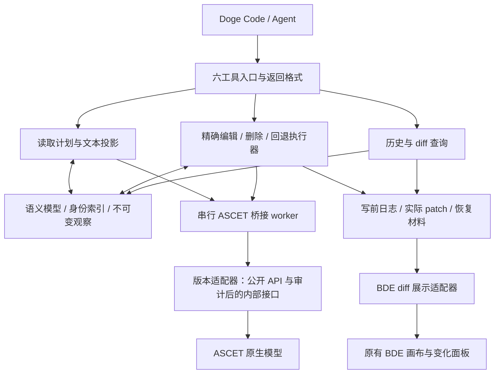

# BDE tools v0.4：读取、精确编辑、修改记录与原生显示

2026-10-07 payload 层：在只读 serializer configuration 回执中加入 source `CTreeSearchObjectRecord` 的完整逻辑/allocated bytes、fixed/blob 长度和 owner key 守卫。该层只导出 retained before payload；禁止把它当成 fresh serialized after 或持久写授权。

[payload 层证据](../analysis/bde-experiments/2026-10-07/bde-serializer-payload-preview-increment-01/README.md)

2026-10-07 fresh v6 已在同一进程复核：new preparation token 同次捕获 component/source owner、reference baseline 和 CTree 状态；随后 serializer configuration 读取固定 role/schema，unchanged reference planner 只生成 0 patch。fresh preparation 的资源仍是 retained before，尚未允许 changed record rewrite/flush/inverse。

[fresh 架构证据](../analysis/bde-experiments/2026-10-07/bde-persistent-owner-increment-02/README.md)

2026-10-07 在 serializer configuration witness 后，有限 reference planner 已消费 retained v6 owner/reciprocal records。它只接受完整 ordered outgoing 与所有目标 inbound before，按 OID 集合计算 owner-only patch；unchanged list 生成 0 patch，并显式保留 self-reference、无关 entries、顺序和 provenance=false。它仍是离线计划，未接入持久 serializer/flush/inverse。

[规划实证](../analysis/bde-experiments/2026-10-07/bde-persistent-owner-unchanged-plan-01/README.md)

2026-10-07 新增只读 serializer configuration layer：`commit_serializer_configuration` 从 v6 retained `persistentOwnerMaterial` 取得 `SGTopGraphicsBlockDB` source，固定绑定 `DBLinDeLin`、`DBSwapperDumperLoader`、`RBObjectDumper` 和 `RBObjectLoader`，导出有限 schema/omission/replacement/loading 描述。agent 只收到严格有界报告，完整配置另存审计；没有 serializer call、store、commit、write 或 inverse 权限。该层为后续 source record rewrite 的前置证据，不能当作持久编辑已经完成。

[在线架构证据](../analysis/bde-experiments/2026-10-07/bde-serializer-configuration-increment-01/README.md)

2026-10-07 v6 已在线接入：`native_commit_prepare_v6` 在 v5 同次 dispatch 内增加 component 与 `SGTopGraphicsBlockDB` source 的持久 owner 捕获。每个 owner 保存 model/DBObject direct image、owner key/OID、CTree before/after 和 owner/reference/inbound record；明确 error 101 的 undefined reference 以 `absent_record_v1` 保存，不能降级为空记录。完整材料留 native/audit，agent/WAL 只留严格绑定 token/owner/generation 的摘要；model setter/store/apply/commit/inverse 均保持关闭。

v5 仍有效：`native_commit_prepare_v5` 继承全部 v4 原材料，并在同一次 dispatch 捕获 `reference_file_baseline`。完整原记录留在 native material；agent/WAL 保存严格绑定 token/owner/generation/profile_index 的摘要，不能降级成 v4。新的 fixed `commit_reference_baseline_lookup` 只在原保留基线选择记录，不重新扫描 CTree；最多 16 个有序唯一请求、原始字节总量最多 1 MiB，超限明确拒绝而不截断。只支持两类引用属性，不接受任意代码或 selector。

查询输出保留原 scan row、ordinal、事件定位和完整 raw tail。`not_observed` 不证明不存在，不能转为空 before；正向已观察记录经严格解码后可供有限双向引用计划使用，不伪造逐记录 CTree 前后图像。已验证 9 旧目标加 1 新目标及未观察键；这是原 before 查询，`current_reference_file_checked/absence_proven/write_authorized/inverse_authorized` 仍 false。实际持久 patch/inverse 尚未实现。

prepare 前先持久写 `commit_capture_requested`；不确定回执停止该连接的后续操作和清理，原 token 只允许查询。原 prepared 注册项释放后 resource 仍保留原对象强引用；禁止相同 token 重新 prepare 后重绑旧资源。在线证据见[交付状态](bde-delivery-status.md)，下面保留历史架构检查点。

2026-10-07 当前已验证架构：原 v4 prepare 保持，固定三参数 helper 读取全部原 outgoing 目标的当前 inbound；`native_commit_status_v2` 使用 `current_reciprocal_records_checked=true` 与 `reciprocal_summary`。report 按保留目标顺序绑定 component/generation/owner_key/原 outgoing/原资源 check index，完整语义和未解析 raw tail 分开比较，逐记录 CTree 前后读取效应独立记录。历史 v1 false 只代表当时未核对，不能升级；失败 partial report 不得回落旧成功结果或生成完整摘要。

真实 Tool03 已核对 9 原目标并独立复算 21 全部差异，其中 9 为 reciprocal 读取 fixedRecord；原 before 和 graph 不变。77 项离线控制与 854 源码/2,662 hash 冻结通过，当前数据差异能力不授予持久写/inverse。新增 outgoing 目标尚不覆盖。[当前架构实证](../analysis/bde-experiments/2026-10-07/bde-commit-reciprocal-current-increment-01/README.md)。

下一基线候选是同次新 prepare 的完整引用文件 record/key 捕获，完整材料留 native/WAL，本地按实际差集取原记录或严格不存在性；agent 仍收紧凑摘要。完整文件只作为 before 证据，不能用于整文件 inverse。66 方法/8 错误资源只完成静态研究；当前 CTGVCTreestdFputFget 非 single-user/transactional，ctCritical 与 marker 不能证明跨进程原子快照。[设计边界和实现顺序](../analysis/bde-experiments/2026-10-07/bde-reference-file-snapshot-route-01/PLAN.md)。

## 此前 v4 原始捕获架构（当前读取之前）

2026-10-07 v4 已验证架构：`native_commit_prepare_v4` 在既有 model/CTree/完整引用长度证明上增加 `reciprocal_references`，同次捕获原 outgoing 所有唯一目标的原 inbound。完整 `original_reciprocal_capture` 留原生材料/审计，紧凑 summary 明确仅为原 before。已验证 9 目标、4,293 semantic/6,382 raw bytes；初次 9 处叶读效应逐记录保存。

v4 校验须同时绑定 component、generation、owner_key 和根 original outgoing 完整记录；新旧 profile 不可静默降级。inspect/check 均明确 `current_reciprocal_records_checked=false`，新增目标覆盖为 false。真实 Doge Tool02 与独立复算已通过，持久写和 inverse 仍关闭。后续当前入站读取与新增目标原材料必须独立补齐，不能将新鲜值当旧 before。83 个 serializer 方法静态研究不授予执行权限。[冻结设计实证](../analysis/bde-experiments/2026-10-07/bde-commit-reciprocal-increment-01/README.md)。

## 历史架构增量（以下范围按各自时点保留）

有限引用规划层新增 plan/check_inbound/check_revert_inbound：outgoing 保留顺序/重复，reciprocal 以 OID 集合求目标；捕获旧新并集校验双向一致。三方 inverse 只改 owner 关联，使用原唯一邻接锚定位恢复，无法唯一恢复则冲突。它不建立写前时点/epoch 证明，不授权持久写或 inverse，必须由原生准备材料和后续执行器绑定。serializer profile v2 的固定入口/完整 literal 核对独立于整个序列化调用闭包，不以入口通过替代后者。

2026-10-07 引用格式修正：prepare 另带 record_length_profile=complete_reference_payload_v2；当前查询 full_reference_payloads_checked 必须为真实布尔值，并独立核对原 retained bytes。tag1 列表为 60 字节 header + 4 字节 count + 21×count，不能用 fixedSize+blobSize 截取。旧 original_capture 不重写，只从其完整原 raw buffer 解码；新查询不能伪装旧前缀为完整材料。语义引用差异与 $unparsed_record_tail 差异分开，未知 tag/profile 拒绝。完整材料留原生/WAL，agent 使用分页摘要。

2026-10-07 v3 资源准备：固定 `ctree_v1` 在记录读取前保存所有 CTree interfaces + referenceInterface 的原身份、registerName、ctInstance wrapper、transaction 返回标记和有序 savepoints；当前前后图像进入实际 WAL。完整材料原生保留，agent 取有界摘要；请求范围与回执版本必须相符。未知或失败材料不能通过释放/重读/换 epoch 补造。

提交边界：默认 store/endModifications 会写全部 dirty cache，并单独提交 referenceInterface；savepoint 不提供跨 autoCommit 的历史回退。精确持久 patch 需要 owner object/outgoing 和引用差集目标 inbound 的存在性/原逻辑字节，另行保护无关 dirty owner。新鲜 serializer 预演须固定类型和分派，不能使用旧缓存 linkObject，也不能放开有 preDump 外部副作用的类型。缓存时间戳/CTree 操作缓冲的实际变化记录为读取效应，不盲目作为文档逆向补丁写回。

2026-10-07：正式 prepare 保留原 DB 资源和 loaded SG 图像，当前查询在同一 native dispatch 中采集查询前/后 SG 字段、值、集合及完整注册成员。所有原对象继续参与当前图像，即使不可达；新引用记为新观察对象，不能直接宣称 DB 创建/删除。集合的实际顺序保留，Dictionary/Set 的迭代排列不算内容修改，实际前后值仍原样存档。原生与独立 Python 复算、Doge WAL/离线 diff 路径已通过限定验证；完整持久 closure 和 inverse 仍关闭。

保持当前 ASCET/数据库打开，复用固定 endpoint，不为实验反复关闭启动或为材料容量重启。见 [运行交接](../analysis/bde-experiments/2026-10-07/runtime-handoff.json)。

2026-10-06双向消息：独立完整CURRENT缓存守卫与原创建图像分别绑定，不将读取
缓存变化误判成语义修改，也不忽略非缓存字段或共享引用。公共API互斥类型与
内部通信位分别校验。原对象三方向历史/完整恢复/release/namespace退休已在
send_receive_message/udisc/local在线通过；六工具保持，完整交付仍false。
[具体实现和完整证据](../analysis/bde-experiments/2026-10-06/bde-message-duplex-status-01/README.md)。

2026-10-06 最新功能增量：独立 SGModule 接收消息原对象历史及完整原状态收尾已
隔离在线通过，完整实际 diff/WAL、严格引用守卫、release/namespace 退休与旧
snapshot 实际写前拒绝保留。仅一个 receive_message/cont/imported，尚非全消息
类型或完整 required case；全交付 false、业务原件恢复仍阻塞，性能只记录。
下一项为 primitive-message 的角色/类型/scope 与已有声明 Module 正式生命周期
和连删，再 NEWENUM/enum/complex 与跨层通路。完整原需求保持，历史段不改 verdict。
[当前交付状态](bde-delivery-status.md) ·
[新实现、在线结果与复算](../analysis/bde-experiments/2026-10-06/bde-message-finalization-status-01/README.md)。

2026-10-05 当前方案保持 **r12**，核心功能完整交付优先，性能只记录。
六工具、全部普通原生适用类型/层级/Class/Module/Project/message/A2A/XPass、
43 required case、独立 oracle 与原有场景/次数保留；整体开发尚未完成。

本轮指定隔离 PID45476/32641 已通过 API 打开精确数据库，并释放临时连接。
新 epoch 的三结构各三轮 read/find/inspect/完整分页通过，共87次 Tool.call。
staged_v1 的 source 原引用捕获准备及11项私有 patch 检查通过；没有模型
setter/store，准备与丢弃后的完整 witness 不变并释放。

带 identity_v1 capture 的 operator_fanout literal 正式完整历史通过：16次
Tool.call，四个不同 change_id/after_snapshot；edit→实际 diff→inverse→redo→
最终恢复，完整原生/source 独立 witness 通过。四个终态均保留99个 before 和
165个 after source 对象材料，source 根对象身份保持一致。120项离线回归通过。
三份试验各601个源文件原字节/SHA封存，旧失败不改 verdict。

这是原材料捕获接入及限定 literal 历史，不是正式局部三方回退验收。
生产 local inverse 仍关闭；下一核心代码任务为 MAIN-03C.5d 局部 native/source
执行、无关修改保留、重叠冲突写前拒绝及回退自身。MAIN-04 显示、类型创建及
接口/通路按自身依赖继续。全类型/跨模块、source 持久化、原件恢复、真实
Doge/AEB_Core、包和完整 required case 仍未完成，没有新增完整 case pass。

[当前方案](bde-core-function-delivery-plan-20261005.md) ·
[任务表](bde-core-function-workboard.json) ·
[最新实现与独立复算](../analysis/bde-experiments/2026-10-05/bde-source-capture-summary-01/README.md)。

下方按原版本保留历史记录；当前状态以上述任务表及新证据为准。

## 历史实现记录（以下按当时版本保留）

2026-10-05最新实现：宿主/模板固定bundle与factory清理已接齐；三参数
patch factory原生编译、跨连接零计划及6项非零私有对象执行通过，每个完整
方向19个原语，live native/source基线不变。生产首次实际终态/源码冻结与
双向patch生成已接代码，尚未执行模型setter/store验证。whole-collection
guard、正式managed执行/store附带恢复、完整历史/显示仍有缺口。
[原始失败、修复与边界](../analysis/bde-experiments/2026-10-05/bde-native-field-patch-summary-01/README.md)。

当前执行方案为 **r8：核心功能完整交付优先**，见
[五个功能包与下一项正式代码交付](bde-core-function-delivery-plan-20261005.md)。
性能只报告；每项操作同时验实际diff、冲突、精确双向恢复与原BDE显示。
字段patch绑定/编译与非零私有执行已通过；实际模型恢复仍未验证，见任务表最新增量。
本次仅修订方案，没有新增功能pass；下方增量和旧方案按各自记录版本保留。

最新材料实现：固定CURRENT helper新增完整原始/终态图像与字段schema导出，
普通字段/layout prepare保留原引用/值/collection及源码材料；模板增加
pre-store/post-store/after-reader捕获点。只有prepare跨连接保留和正式read/
preview做了在线验证，345对象/1555槽；没有新的setter/store/inverse证据。
失败witness不再自动释放，旧缺材料managed head在写前拒绝。NEXT MAIN-03C.2
实际双向patch和局部执行，精确恢复仍未完成。以下是此前记录版本。
[证据与边界](../analysis/bde-experiments/2026-10-05/bde-native-material-summary-01/README.md)。

最新实现：固定managed字段/layout双向执行和后续head移交已接正式bd_revert；
只有literal实际正反执行，30次工具调用恢复所采语义/public图。完整native
field/source见证失败，Point旧对象值与引用仍有差异，不能当作精确恢复通过。
MAIN-03C须在准备期保留完整原生字段材料并按实际patch恢复。下方“尚未接通”
属于前一记录版本；当前缺口见[任务表](bde-core-function-workboard.json)和
[原始失败](../analysis/bde-experiments/2026-10-05/bde-main-managed-summary-01/README.md)。

当前实施修订为 `bde-functional-delivery-r7-20261005`，见
[交付方案](bde-core-function-delivery-plan-20261004.md)。六工具、typed schema、
固定原生接口、不可变观察、局部实际 journal 与串行活体访问继续复用。
顺序按实际任务：字段/layout 历史闭环→连续连线/删除→类型→hierarchy→
Class→message/Project 通路→视觉矩阵收尾→完整包；显示随每项 edit 接入。
每条操作自身的恢复合同是写入前置，全部 family 的历史验收不是无关开发锁。
性能只报告；所有必需功能、真实 agent/AEB_Core、原件恢复和实际包仍保留。
下一项是 BDE-01 / MAIN-03C.1–5：先完整原生材料与失败诊断，再生成实际
双向字段 patch、局部冲突/精确执行、正式日志/recovery 和在线/显示验收。
首次正向走原生接口；回退恢复已保留原对象字段/引用，不靠重复 setter 或
回填旧整图 source。结构不变量与 patch 单元分别核对，保留无关编辑。
强引用用于同 epoch 恢复，JSON 用于审计；重启后不从 JSON 重建原身份。
独立 witness 写前捕获、失败保留，完整 oracle 不放宽。
以下增量及 r5/r6 条目按各自记录版本保留，本次方案不新增功能 pass。

2026-10-05 材料生命周期增量：verified 原始 inverse 后优先调用固定
retain_inverse，保留现有 native record 并绑定新 inverse change。持久
retention intent/proof 后确认 pending；丢回执用正式 recovery 查询 fresh
ownership 和模型终态，不重发。普通三条流程和两种 metadata 故障已有局部
在线证据；后者的 inverse 执行使用固定 native-journal eval adapter，不能
充当完整正式编辑故障或真实 TCP 断连。多次 diff/分派使用有界 ancestry，
但 managed 原生再回退及后续 head 移交尚未接通。
[独立证据](../analysis/bde-experiments/2026-10-05/bde-main-retain-summary-01/README.md)。

2026-10-05正式路由增量：结构edit及其inverse的bd_diff使用StructureJournal
局部语义patch、父/绘制顺序delta与native变化摘要，不将整个CURRENT恢复
图重新发送给agent。完整native字段细节留在原WAL，返回明确标注该边界；
没有减少声明的语义row变化。结构inverse的再回退也正确进入结构guard，
目前明确REVERT_UNAVAILABLE，尚未接native材料移交，不能作为已实现。
真实literal/删除/断线流程和最终6次离线diff调用已验证具体范围，完整
功能case仍未验收。[证据](../analysis/bde-experiments/2026-10-04/bde-main-workflow-summary-01/README.md)。

2026-10-04 最新优先级：用户要求以全部核心功能为交付标准，取消一秒延迟
作为前置门槛。六工具架构、精确身份、实际局部 journal、冲突与回退和原 BDE
显示保持；Module/Class/hierarchy 的完整 FLOW/A2A/XPass 纳入正式功能验收。
不再为延迟指标单独扩展研究或重测。新实施顺序及完整判据见
[核心功能交付方案](bde-core-function-delivery-plan-20261004.md)，机器策略为
eval-v2-functional-delivery。以下性能门槛与阶段状态按其原版本保留。

实施方案修订为 `bde-functional-delivery-r5-20261005`：以正式功能缺口和
具体操作依赖推进 Main、hierarchy、Class 及跨 Module/Project。MAIN-05
开发不再依赖 MAIN-03 全量完成，每条在线写入仍需自身的局部 actual journal、
冲突和精确恢复合同。MAIN-03A–D 分别接原生材料归属、正式多次 inverse
路由、双向原生恢复和真实工具验收。现有类型目录/验收入口继续随功能补齐，
完整 Main 和最终交付仍须所有必需功能闭合。
六工具、引用、unknown 和恢复guard沿用；pending未收敛的资源停止后续写。
视觉环境缺失可转向独立类型补齐，完整显示门槛仍是最终交付条件。
独立验收入口v1已接G0离线固定适配器，30tests及原始证据重算通过，
CONTRACT-02离线合同在其记录版本通过；其他完整case仍缺覆盖。下一项
MAIN-03A，其他无该依赖的类型/读取/接口开发可递补。此方案调整没有新增
功能pass。详见 [验收入口](bde-tools-acceptance-runner.md)。

M0首个正式增量：`bd_inspect(query=block_types)` 离线返回现有26类普通BDE
的typed创建字段和各owner/scope条件操作，支持单类型详情与既有完整分页。
26个native factory静态绑定、23个operator输入数、7个controls及schema一致；
额外GUI工厂/端口清单未穷尽。实际Doge目录查询0Cebra帧，不是ASCET在线功能
验收。参见 [目录使用与证据](bde-block-type-catalog.md)。

最新 release 处理：CURRENT 材料存在时，release 在既有 candidate 上保留封存
的只读 witness，再删除 publication record。publication 和 native classify
可从这个证明重新核对完整 native/source/signature/configuration/object identity，
但没有恢复执行权限；无证据或发生变化拒绝。candidate 清理同时使 witness 失效，
没有新常驻全局记录。旧非 CURRENT publication 正常释放不建立该证明。

Python 按 fresh presence 唯一判定 release 未执行/已完成。已完成仅写独立
release_reconciled 与 terminal，0 native dispatch / 0 model setter，不补写旧日志。
3 个真实 ready/restored、base/deep 案例累计核对 10 owners 并恢复完整原始基线；
正常 complete02 与最终条件的 legacy01/ready04 也通过。生产 Class 局部回退
及整体验收仍未开放/通过。以下保留旧版本历史描述。
[独立证据](../analysis/bde-experiments/2026-10-04/current-release-summary-01/result.json)。

最新恢复链支持多个不可改写的 recovery WAL，按时间顺序绑定所有前序段。
pending 保留原 native token，并原子绑定最新恢复 journal/intent checksum。
Python 在连接前核对完整历史与 head，C# 每次派发前再次核对；每段 intent
必须由完整 fresh native/public/source/signature/configuration classification
证明全部历史实际状态，不补写旧 completion，也不重发已完成的 inverse。
单次审计内可缓存重复前缀，禁止跨调用复用 live 分类。

metadata 完成丢回执、inverse 完成丢回执和 restore_store 调用前故障已通过
隔离两段/三段恢复及完整原始基线/absence 验证。另有默认关闭的显式
`--current-complete-study` 无故障研究入口，base/第三层 hierarchy 各一轮、
7 个 owners 的完整 CURRENT cycle 与后续普通/strict Class inverse 均通过。
它不开放正式 Class 局部回退；unknown release、真正断连/重启及完整交付门槛
仍未通过。以下是旧版本对应的增量记录。

[最新实际闭环](../analysis/bde-experiments/2026-10-04/current-complete-deep-01/result.json) ·
[恢复链复核](../analysis/bde-experiments/2026-10-04/current-recovery-chain-summary-02/README.md) ·
[完整闭环复核](../analysis/bde-experiments/2026-10-04/current-complete-summary-01/README.md)。

Latest CURRENT increment: actual primitive/Store/deep after-native faults recover
10cumulative owners and full CURRENT/original baselines. Complete classifications
authorize only metadata accounting(0new setters) and remaining causal inverses.
The first unchanged failed metadata dispatch has an explicit prior-WAL-bound
retry;other interrupted recovery/unknown release are still refused.58focused
tests pass. Production Class local inverse/unfaulted complete CURRENT cycle and
remaining full gates stay incomplete. Earlier paragraphs are historical.
[Evidence](../analysis/bde-experiments/2026-10-04/current-unaccounted-summary-01/README.md).

CURRENT protocol increment: full forward/inverse and separate recovery WALs are
implemented. A fixed recovery entry rechecks the exact original bytes/WAL/domain
and complete fresh classification, reverses only remaining causal native steps,
and observes full restoration before journaled release. Base/deep actual pre-native
faults verify7owners with0CURRENT setters;each recovery uses1metadata release.
51focused tests cover dynamic collateral, both unique outcomes at12inverse
boundaries and refusal of changed evidence. This is not live CURRENT mutation/
store/inverse acceptance. Unaccounted action, unknown release and recovery-WAL
interruption remain next;physical writes stay disabled except the guaranteed
pre-native fault. Six public tools and production Class inverse remain unchanged.
[Protocol and evidence](bde-class-current-recovery.md).

The increments below describe their recorded predecessor source versions.

CURRENT inverse increment: the fixed executor and private native probe share exact
projection/execution/inverse helpers. Complete primitive and dynamic store collateral
inverse plans are exported and independently sealed. A separate value-only checker
verifies six collection kinds,exact prefixes and full restoration;the forward WAL
auditor consumes its actual plan length. Private native execution passes49assertions/
15steps with live-field equality;base/deep bindings verify11proposed inverse effects.
Physical inverse WAL/unaccounted recovery/actual CURRENT stores remain required.
Six public tools and production strict Class inverse remain unchanged.
[Evidence and limits](../analysis/bde-experiments/2026-10-04/current-inverse-summary-01/README.md).

CURRENT atomic-context increment: the sealed publication group retains a complete
signature/argument/return/owner/configuration/source guard. The fixed executor
checks it inside its native call before/after each future action. Historical source
seals are distinct from ready-only CURRENT binding. Real ready/publishing refusal
audits pass112assertions on7owners, with complete baseline restoration and fresh
record absence. No CURRENT setter/store or new public tool is enabled.

A dedicated offline forward-prefix auditor checks exact command order, native
effects, complete source/signature classification and one missing-return outcome.
It ignores diagnostic replies and grants no recovery dispatch. Physical WAL,
inverse/unaccounted-action recovery and production Class local inverse are still
required.44focused tests and987Python/21Doge regression pass;6live skips remain.
[Current independent proof](../analysis/bde-experiments/2026-10-04/current-context-summary-01/result.json).

Current exact-plan increment: each proposed CURRENT primitive has a sealed
pure-value field/collection diff before dispatch. Shared observation aliases and
complete ordered members bind the plan to the retained native objects. The
preflight WAL now includes a read-only classification of complete sources,
signature/configuration and original native prefixes. Base/deep01 and independent
summary01 verify7owners/11effects/14source classifications/full baseline restoration.
No agent selector/source/native-handle API is added. The dedicated default-OFF
CURRENT recovery entry supports classify only; actual primitive/store dispatch,
unknown reconciliation and production local inverse remain incomplete.
[Current evidence](../analysis/bde-experiments/2026-10-04/current-step-plan-summary-01/result.json).

CURRENT execution increment: a fixed native executor prepares exact actual-object
primitives and snapshots under a default-OFF research flag. Sequential removal
indices, detached desired Points, newly observed nested objects, six collection
kinds and copied operation/snapshot seals are handled. Final base/deep preparations
and the private 53-assertion capture probe pass; no new CURRENT mutation/store path
is enabled. Receipts contain values and counts; native references remain internal.
Six public tools and strict Class inverse remain unchanged. Dedicated per-primitive
CURRENT WAL, partial/unknown recovery and actual post-store identity acceptance
must precede production integration. [Contract](bde-class-current-execution.md).

Current recovery increment: default-off actual publication journals complete
CURRENT and every physical signature/store dispatch. A separate read-only
planner proves the exact confirmed WAL prefix plus the unique unknown outcome,
then a separate recovery WAL records only remaining actions. Fresh mixed smoke
passes the complete96case three-fixture x3matrix,independent full-WAL summary02
and fresh3fixture public-audit02. Transitional primitive native signatures
preserve all collected fields and are compared with public signatures whenever
available. Six public tools stay unchanged and formal Class inverse remains
strict whole-owner. No restart/archive/native-setter-fault authority is implied.
[Recovery protocol and limits](bde-class-publication-recovery.md).

CURRENT native identity increment: compile04passes both fixed templates inside
ASCET. A default-OFF read-only audit is integrated after publication seal and before
the first setter;its independent verifier checks full owner/target/existing-pin
coverage against prepared patches. Final templates/ready-state base03/deep02now
pass with7owners/7targets/48pins/4planned coordinate setters;summary01independently
rechecks full source/WAL/baseline restoration and temporary-record absence. The existing
publication still stores private patched diagrams;post-store CURRENT object
preservation and later ordinary inverse compatibility are still unproven.
[Identity contract](bde-class-current-identity.md).
The lower chronological increments refer to their original source versions.

Current patch increment: fixed current-clone input removal binds exact created
formal/method identity and source/scope/WAL witnesses. Three base rounds pass9owner
sources/9removed pins/3undrawn definition no-ops/39private inverse steps. Both source
planners retain current native allocator high-water. Mixed third-level complete
source comparison fails4return-port Y fields;full comparison stays strict and
production Class local inverse remains unavailable. Native model publication,
durable CURRENT/WAL/partial recovery and whole delivery are still required.
[Current contract and failed profile](bde-class-current-runtime-patch.md).

Storage-return increment: fixed private source-reference mode retains the real
export IdentityDictionary and binds each native graphical member to its actual
storage return,parent and scope. Hierarchy container assembly is distinguished
from direct native returns. Sealed native tuple/metadata pointers and independent
full source/scope/WAL oracles pass63images across6base/deep rounds;168private
faults reject and restore. The existing live guards remain strict. Export refs
are image-local,not agent handles or cross-capture edge IDs. All receipts retain
write_authorized=false. No agent tool is added;merged runtime execution/durable
CURRENT/model WAL/partial recovery and whole delivery remain required.
[Current contract](bde-native-storage-witness.md).

Retained-history increment: default-OFF Class material capture copies the original
and applied mutable native graphs while their exact live checkpoints are current.
A separate private seal checks complete historical field/collection images and
memo/material/source identity after later live changes. Original/applied complete
source/WAL-generation oracles pass42images across6base/deep rounds;all6moves change
the old live graph but not its copy. Current live guards remain strict. Private
source normalization135fields and126seal negatives restore exactly. No agent
tool is added;actual merged publication/local inverse/durable CURRENT remains.
[Contract](bde-class-native-source-runtime.md).

Current runtime prerequisite: fixed native source generation operates only on
memo-owned current graphical clones and separate source images. Existing private
CURRENT capture/diff/inverse records and reverses96actual cache allocations.
Independent complete-source value/sharing comparison and live full context guards
pass21owner observations across6base/deep rounds. No dynamic agent code or new
tool is introduced. Model publication still needs original/current native lineage,
merged patch,per-step model WAL and partial recovery. [Contract](bde-class-native-source-runtime.md).

Latest2026-10-04: bounded8native source candidates retain independent source
images and exact current/original runtime witnesses,signature/configuration and
scope generation. The shared lifecycle policy pins prepared candidates. A separate
candidate WAL journals private lifecycle calls without authorizing model writes;
unknown outcomes cannot retry automatically.6base/deep rounds verify21owner
preparations,duplicate reuse/stale refusal/release and full separate restoration.
Actual merged native publication and Class local inverse remain unavailable.
No agent-facing tool is added. [Contract](bde-class-local-source-inverse.md).

Current2026-10-04: formal source-candidate preview independently verifies every
scope's endpoint ownership and target Class declaration/formal aliases using
audited native child-ID getter witnesses. Full exports remain evidence;compact
analysis/fingerprints reach the agent. Value compatibility and dependency validity
are separate results. A new-input connection yields a dangling-endpoint conflict
when its original Class creation would be reversed. Actual merged-source execution
remains unavailable;candidate write_authorized=false. Strict inverse allows only
verified monotonic registry extensions with complete original identity/source and
scope/generation checks. Six tools stay;whole delivery remains INCOMPLETE.
[Current contract](bde-class-local-source-inverse.md).

Previous configuration increment:

Latest2026-10-04: optional per-bridge native configuration guards capture immutable
complete baseline text and exact owner identity,then freshly read and compare all
configuration fields before each dispatch. Observations retain complete values;
successful guards return only a fixed result. No setter batching,guard removal or
persistent mutable snapshot cache. Fixed caller-batch cached-error handling now
uses the verified String selector.36formal rounds/48synthetic native checks/full
public audits pass;30sample create/inverse P951221.192/1064.938ms still fails1second.
Six tools stay;profile defaults OFF and whole delivery remains INCOMPLETE.
[Current implementation/evidence](bde-tools-experiment-report.md).

Current2026-10-04: an opt-in per-bridge fixed read batch combines caller graph
observations and complete scope/configuration traversal. Existing fixed field
readers and separate native mutation/WAL/precondition boundaries remain. Public
oracles never batch;the bound factory is outside the fixed read-template cache.
The36round matrix/full public audits pass;30sample P951231.246/1098.020ms still
fails1second creation/inverse targets. Six agent tools stay;whole delivery remains
INCOMPLETE. [Current implementation and evidence](bde-tools-experiment-report.md).

Previous candidate:

Current2026-10-03: scope cache certificates bind actual process epoch identity
and issued generation. Bootstrap preserves retained root objects/generations;
subsequent obsolete-reader roots receive fresh global generations. Scope12/14
and causal regression02/fresh audit02 verify migration, actual legacy reset/stale
refusal and current-candidate ordinary inverse compatibility. Six tools stay;
legacy/inventory diagnostics are research-build-only. Whole delivery INCOMPLETE.
[Contract and remaining acceptance](bde-scope-lifecycle.md).

Previous candidate:

Current2026-10-03: the fixed reader owns bounded64root lifecycle with audited
retained-material pins, deterministic LRU and a process-wide monotonic generation
high-water mark. StructureJournal rejects old generations before preparation;
ESDL specification guards precede cache acquisition. Six agent tools remain;
native inventory/policy/unused-retirement probes are research-build-only.
Scope09/causal regression01/audit01 verify declared scope; whole delivery and
active UI/Class/private/sustained-pressure acceptance remain INCOMPLETE.
[Lifecycle contract](bde-scope-lifecycle.md).

Previous candidate:

Latest2026-10-03: verified inverse release preserves bounded original drawing
witnesses in related applied records. Only a drawing-gap ambiguity may use them,
with exact native identities/generation/mappings and projected BEFORE/CURRENT.
Metadata/maps/encoded proof are frozen and rechecked before setters. Python binds
the verified released source WAL; full proof stays durable and agent receipts
carry IDs/hash. Preview/execution/recovery share this contract; released recovery
validates actual hashes without native calls.27rounds/54inverse proofs pass this
scope;full family/fault/Class/UI/FLOW/package and64scope lifecycle remain.
[Exact contract and limits](bde-causal-drawing-order.md).

Previous candidate:

Latest2026-10-03: separate attached-order repair handles completed inverses whose
objects are present but drawing order differs. Full original WAL raw numbers
prove the desired order;exact root/owner/generation/ids/physical collection and
CURRENT are frozen before dispatch. Only drawingOrder setters/store are allowed;
complete raw actual diff and public sequence verify the result. A new
research-only fixed command is absent from production builds. Deletion01 repair
and fresh audit pass;this does not implement production causal witnesses.
[Recovery contract](bde-attached-order-recovery.md).

Previous candidate:

Current2026-10-03 update: Deletion03 is separately restored with exact retained
object identities and complete raw/current/physical/drawing baseline evidence.
The research helper is compiled only under BDE_DRAWING_LINEAGE_EVAL and absent
from normal production builds. Partial execution uses read-only inspect, a new
store-only completion and read-only reconciliation, never mutation replay.
Production must still preserve bounded identity-bound original-order witnesses
before releasing records;reload/generation changes must invalidate them.
General causal inverse/fault/Class/UI/FLOW/package gates remain incomplete.
[Exact restoration contract](bde-retained-layout-recovery.md).

Previous candidate:

Current2026-10-03: ordinary deletion now binds a fifth fixed helper for sorted
drawing order. Before/applied/CURRENT plans independently merge physical and
drawing sequences; complete normalized-number evidence stays durable, with compact
actual effects returned to agents. Native store and Python inverse/recovery verify
the same expectation; released recovery refuses missing original/inverse evidence.
Literal-fanout three-round exact restoration passes. Operator-chain's secondary
inverse refuses a causal same-gap ambiguity and remains unrecovered; full lineage
witness/recovery/family/fault/UI/FLOW/package acceptance remains required.
[Implementation, exact evidence and current limit](bde-independent-deletion-drawing-order.md).

Previous candidate:

Latest2026-10-03 architectural gap: parent physical children and sorted drawing
order are distinct contracts. Deletion01's two formal inverses restore collected
values but fail exact public node order. The current value projection omits
drawingOrder, so its verified_local receipt does not establish full graphical
restoration. Require independent before/applied/current drawing-order plans,
durable expected order and store-time/raw/public checks before accepting this
scenario. No new tool surface or production write route is enabled.
[Failure and audited call chain](bde-independent-deletion-drawing-order.md).

Previous verified increment:

Current2026-10-03: ordinary delete/disconnect inverse merges deleted rows into
CURRENT through independently checked Python/native typed plans. WAL contains
the merged expectation before setters; actual result/recovery/preview validate
it together with exact raw/parent/endpoint preconditions. Released reconciliation
recomputes the durable plan without native calls. Six agent tools and bounded
receipts remain; no arbitrary native source API.18actual rounds/12application
reply losses pass this scope; six more guard rounds bring the total to24actual
rounds/39tampers/78refusals. Whole delivery remains INCOMPLETE;
all-family/raw identity/nativefault/Class/UI/FLOW/package and64scope lifecycle
remain. [Current contract and evidence](bde-independent-edit-inverse.md).

Historical detached-material increment:

Current2026-10-03: ordinary inverse adds a local detached-original terminal
checkpoint with exact traversal boundaries and raw reference/field/content
checks. Preview/execution recheck it before mutation;capturing CURRENT cannot
bless altered originals. Material10/11/12 pass9actual rounds/39native tampers/
78native refusals/complete final restoration. No new production agent API;
six tools remain. Independent-edit three-way inverse and full raw identity
remain open;original Class hold stays. Entire delivery INCOMPLETE.
[Contract/evidence](bde-detached-graphical-material.md).

Historical terminal recovery increment:

Latest2026-10-03: native raw terminal images/verifyAfter now bind recovery status
and durable reconciliation to original/started CURRENT/signature/actual evidence.
Whole-frame graph evidence remains in WAL;agent receipts/diff remain compact.
18actual delete/disconnect rounds and12application-level completed apply/inverse
receipt losses pass declared public/native restoration and no-replay checks.
The existing six tools and business-write/hold boundaries remain. Complete raw
original identity,independent-edit/family/nativefault/Class/UI/FLOW/package gates
are still open. [Contract and evidence](bde-ordinary-graphical-recovery.md).

Historical initial raw integration:

Latest2026-10-03: ordinary delete_node/disconnect_data joins native immutable raw
CURRENT/prepared signatures/actual effects to the existing journal. Complete
descriptors remain in WAL;agent receipts and diff receive compact summaries.
Mutation requests carry a scalar signature checked with direction/full CURRENT
immediately before setters. Actual raw evidence validates before pending release.
Formal inverse retains original registration collections where captured. Production
delete/diff/revert passes3real rounds on1fixture with independent complete public/
native restoration,not whole-tool/3fixtures x3/performance acceptance. Raw
recovery_status/reconciliation,all original raw fields/branch-Set identity,other
operations,Class/UI/FLOW and final package remain open. Original AEB_1 restoration
hold remains enforced. [Current scope/evidence](bde-delivery-status.md).

2026-10-03: fixed private Cebra command blocks now retain opaque native material,
export complete memo fields plus audited generated branching Sets, and execute
one expected step after a flushed host WAL intent. Actual results and read-only
receipt reconciliation are recorded separately. Three rounds/36 private sessions
pass; production model edits, native archives and full delivery remain incomplete.
The six agent tools, bounded responses and original hold remain enforced.
[Protocol and remaining integration](bde-native-private-step-protocol.md).

Latest2026-10-03: private native checkpoints add complete keyed scope/node/port
slots and bidirectional member refs,including empty method ports/hidden pins.
The fixed bound-plan generator saves current container/order/links and exact
original insertion/current removal refs. It rejects unproved native lineage and
subtree dependencies; only private copies are replayed.3 real-current no-op rounds
and4Doge material compilation/binding preflights pass. Existing six tools,strict
baseline/recoveryhold and normal bounded responses remain;actual local inverse/WAL
and full delivery are unaccepted. [Contract](bde-keyed-collection-plan.md).

Latest2026-10-03: bounded three-way member order plans now join Class inverse
value previews, with minimal insert/remove steps and unambiguous independent-pin
preservation. A fixed native kernel executes these steps only on private copies;
3 rounds/144 cases pass with full public bookends unchanged. Exact root/hierarchy
parents are retained without sibling inference. No live manager/edge rebinding,
local model inverse/WAL or write acceptance is granted. The same six tools and
strict baseline/hold guards remain. [Core and execution boundary](bde-collection-merge-core.md).

Latest2026-10-03: native material now retains real scope/object references and
complete immediate parent member order/links, with separate before/after
checkpoints. Inverse/restore/reconcile guards and compact recovery-v3 previews
reject missing or changed old material. Three current-state native checkpoint
rounds and twelve real Doge compile/bind preflights pass; actual deletion/restore,
native local splice/WAL, durable archives and whole delivery remain unaccepted.
[Collection checkpoints](bde-native-collection-checkpoints.md).

Previous2026-10-03: native Class recovery v2 adds a bounded ordered graphical field
checkpoint for retained originals. Formal previews return typed compact checks;
the full field projection stays in native memory. Preparation/inverse guards
refuse old records without a checkpoint. Three current-state public-oracle rounds
pass; positive deletion/restore, native merged inverse and full delivery remain
open. [Material guard](bde-native-material-field-guard.md).

Current 2026-10-02 architecture adds local immutable Doge continuation with Python
parity/fallback and preserves the write dispatch/cancellation boundary. read15's
30 fresh complete Class reads reach P95=933.749 ms across all pages; this is one
measured profile, not universal PERF-01 acceptance. Native inverse preview exists;
30 fresh AEB_dFxTar semantic03 reads independently reach P95=663.115 ms. Its
reader resolves/rechecks exact endpoint identity when multiple ASCET instances run.
Positive retained/capacity/partial paths, Class creation and scoped inverse remain
open. Full delivery remains INCOMPLETE and the AEB_1 restoration hold stays active.
[Current contract](bde-class-tools-usage.md).

Class argument creation now has an independent exact method selector, fixed typed
native template, all-owner creation WAL/retained-loader plan and actual effect
validator. The six tools expose `create_class_argument` read-only preview:
primitive input arguments and one planned pin per exact caller occurrence.
Declaration mutation and graphical materialization remain separate journaled
steps. Actual creation/inverse is withheld until its live gate; preview does not
allocate native recovery, reserve requests or clear the original database hold.
See [the creation contract](bde-class-argument-creation.md).

Latest frozen-record/Esw-stream research remains separate from tool execution:
the original formal's raw alias is outside every CRC-valid tested-profile stream.
No complete original material is established; a byte sighting never authorizes
restore or clears the hold. Destructive Class edits still require original native
material, and durable native recovery/reload linking need independent audit and
acceptance before restart restoration can be enabled.
[Source and record evidence](bde-recovery-record-audit.md).

2026-10-02 continuation: Class deletion preview uses the same complete recorded
owner identity/graph/configuration observation as edit preflight, without recovery
allocation or request reservation. Planned removals and layout candidates remain
distinct from actual WAL effects. An immutable database restoration hold preserves
a known unrecovered experimental failure across epochs/STORE directories. New
journal preflight and lower-level mutations fail before native dispatch; read,
offline diff/history and read-only preview remain available. Native inverse preview,
Class creation and whole delivery remain incomplete. [Latest report](bde-tools-experiment-report.md).

2026-10-02 current architecture: bd_class_tools.py is an opt-in isolated adapter
under the existing six Doge tools, with native automatic caller discovery,
all-owner observations/configuration guards, separate apply/inverse, immutable
WAL/receipts, request deduplication and terminal-only fresh reconciliation.
Its strict all-owner inverse refuses any later owner change. Partial/unknown WAL
and stale-process inverse remain refused. This is implemented experimental
integration; general production Class acceptance is incomplete.
[Contract and limits](bde-class-tools-usage.md).

Class read closure and write authority are separate: read-only observations retain
unsupported references, publish write_resource_error and sample them again; edit
closure still rejects unsupported references before mutation. The current display
uses an existing exact controller item identity and checks deep Undo content;
automatic component.edit is removed because DEFAULT Project creation is a real
side effect in the recovered native call chain. Closed editors fail explicitly.
The source copier avoids Object.dbObject for bare SGGraphicObjectsDB objects.
This alters shared native reader/display code, so historical visual/performance
results are not silently granted to the new candidate. Full UI acceptance and
the outstanding restarted display01 restoration remain open.

Historical 2026-10-02 persisted Class config guard: the isolated native executor captures
all-owner typed storage with linked configurations, sharing/cycles, mutable scalar
objects, Float bits and OID/object bindings, and rechecks it before every dispatch.
WAL actual after/restored and offline diff cover the same graph. Unknown storage
types/overflow refuse. Effective Project/instance values and external type content
remain boundaries. Six native rounds and three AEB_Core observations pass; the
unsafe temporary-enum dbObject getter failure is retained and that getter removed.
Formal Class edits remain disabled pending separate apply/revert, requests/recovery
and native visual acceptance. See the latest experiment report.

2026-10-02 automatic Class owner planning: native caller discovery supplies the
execution owners; experiment fixture lists are no longer backend authority in
the opt-in research mode. The closure includes definition/owner OIDs, paths,
owner kinds, declarations, all Main hierarchy scopes and exact occurrence/model
bindings, plus known metadata-reference identities. Requested formal pin/layout
changes are deliberately excluded from its stable identity projection. Every
journal dispatch rechecks this closure; a supplied stale hash refuses before
preparation. Unsupported references, non-BDE/other roots, declaration-only owners
and native recovery capacity overflow refuse. The UI can still change between
RPCs; these checks do not establish an atomic transaction or full configuration
coverage. Fifteen online rounds pass; Class formal production integration remains
disabled. [Evidence](bde-tools-experiment-report.md).

2026-10-02 Class preparation increment: the native isolated executor now persists
one complete collected resource set before any mutation, then immutable
started/completed events, actual observations and whole inverse preflight.
Database identity and clean editors are checked per dispatch; unknown writes
stop subsequent mutation and retain an instance quarantine. Offline actual diff
does not reconnect ASCET. Three-formal/nine-round evidence restores original
objects across nested callers; a fresh read can release only a known fully
restored study's own quarantine. This groundwork does not enable formal Class
edits or provide full configuration fingerprints/restart restoration.
[Evidence](bde-tools-experiment-report.md).

2026-10-02 construction update: fixed templates still own all native access.
An immutable plan now supports explicit create/connect dependencies; generated
pin identities come from verified actual patches, with component-wide model
effects propagated to same-owner scopes. The existing group journal persists
each resolved intent before its setter. Native identity/order/reference guards
and whole virtual reverse patches precede any inverse. No additional agent read
is required between steps. [Contract](bde-construction-tools.md).
Original display callbacks carry an ownership token; old clear cannot remove a
newer diff. Class body entry joins and ownership guards have bounded three-round
online evidence; full interface edits, visual/reload/fault and eval remain open.
Reusable technique: [in-process query pattern](bde-in-process-query-pattern.md).

2026-10-02 recovery update: shared enum edits retain native terminal library
effects alongside graph observations. Unknown apply/inverse receipts are
reconciled only when current graph and library identity/items/references match;
an inverse additionally matches the original before and removes its owned type.
The six-tool surface is unchanged. Three components / nine controlled fault
cycles pass; dependent shared-resource groups and cross-restart restoration
remain separate requirements. Child geometry02 completed; visual02 has actual
zoom/scroll/reopen evidence but excludes the non-color added marker, so full
visual acceptance remains pending.

2026-10-02 implemented additions: Project/instance observations carry a native
database object token and bounded alias chains. Offline `project_signal_path`
joins captured interfaces without treating unknown Class bodies as data edges.
Independent `steps` groups use one live lock, durable group intent and actual
local journals, complete resource preflight, per-step rechecks and reverse
restoration. The existing Python backend remains the executor; no new host is
introduced. See [current group scope](bde-multi-resource-tools.md). Same-root
dependent steps, shared definitions and complete connect_path are still targets;
group execution is not a database transaction.

2026-10-01 架构扩展见 [BDE 跨组件信号通路](bde-signal-flow-tools.md)：在现有六工具中增加 interfaces/signal_path/connect_path，区分图内连接、message channel、Class formal、hierarchy boundary 和执行关系。单组件接口/路径查询已注册 Doge，固定临时 Smalltalk block 采集、原生双向 hierarchy 配对和不可变观察离线路径分析已实现；[列式正文](bde-signal-interfaces-usage.md)保留原文档字段，详细原生身份按需 inspect。Project/Module/Class 实例链、connect_path、多资源 actual patch 聚合和逆向仍为设计目标，不声称原子事务。

最新范围：先完成普通 BDE tools 的设计与实现，Code Mode SDK/执行器、其他宿主框架工作以及状态机扩展均暂缓；保留原有工具调用入口，不为本阶段新增执行平台。

2026-10-01 hierarchy 节点增量：现有结构视图按原生 ID 链选定子图，在同一 root generation 下创建指定类别、删除普通 occurrence、连接/断开/换源，并沿用实际局部日志与 after_snapshot。声明仍属于组件；创建逆向额外核对根图及嵌套层级中的同声明 occurrence。新建 hierarchy 的逆向还核对子图创建后检查点，避免删除后续内容。子图接口编辑未开放；原 BDE 显示现通过单独解析 UI 层级对象接入实验入口，按日志 scope 定位且跨 scope 暂停绘制，视觉验收仍未通过。类别及证据见 [hierarchy 用法](bde-hierarchy-edit-usage.md)。

2026-09-30 审查后执行更新：普通 BDE 优先，状态机扩展暂缓。当前实施顺序和退出条件以 [普通 BDE 计划 B1–B9](E:/Repo/ASCET/docs/bde-only-execution-plan.md) 为准；Code Mode 接入遵循 [修订批次 C0–C5](E:/Repo/ASCET/docs/bde-code-mode-architecture.md)。本文件保留总体需求，旧实施顺序不覆盖此次将身份、恢复及执行生命周期前置的决定。新增计划项尚未实现。

2026-09-30 更新。本文是需求与目标架构，汇总用户全部要求，并修正 v0.3 的读取成本和编辑日志定位。局部读取与单 literal 日志核心、原生 adapter 及 Doge 隔离写入口已实现，其余仍属目标，不能将本文当作运行能力清单。当前 read/find/inspect/diff 子集及限制见 [Doge 接入说明](E:/Repo/ASCET/docs/doge-block-diagram-tools.md)，在线与离线证据见 [实验报告](E:/Repo/ASCET/docs/bde-tools-experiment-report.md)。

## 1. 必须一起满足的需求

| 需求 | 验收结果 |
|---|---|
| 高效 read BDE | 能完整读取指定范围的逻辑，也能定向读取目标；减少真实远程调用和交付数据，明确覆盖与缺口 |
| agent 看懂返回数据 | 稳定、紧凑的模型文本；保留身份、类型、引脚、连线、执行关系、公式、方法与状态语义 |
| 高效、精确编辑 | 目标和旧值条件明确，局部校验和回读，不为每次编辑重读整图 |
| 编辑自动记录 diff | edit 内部保存实际 before/after、请求与副作用；agent 不手动编排日志 |
| 原有 ASCET BDE 内显示 diff | 在正在使用的 BDE 中看到新增、修改、删除及连线变化，能定位；不能仅交付外部文本 diff |
| 精确删除 | 区分图形实例、连接、状态转移和共享定义；明确受影响对象及恢复材料 |
| 回退 | 针对本次 patch 检查冲突并恢复，保留无关后续修改；删除恢复需证明身份和关系可恢复 |
| Doge Code 可调用 | 接入原生工具及有界返回，执行状态和错误可供 agent 决策 |

上述是同一个最终闭环。分阶段实现不能把后面的要求从完成标准中移除。

## 2. read 返回：小型控制信息 + 可读模型文本

所有工具读取统一的语义模型，但 agent 默认只接收一种紧凑正文，避免同一数据同时返回大 JSON 和大文本。完整底层记录保存在服务端，用于校验、查找、diff 和恢复。节点注释、原生字段等可按需 inspect；行为相关内容不得作为冗余删除。

建议控制信息：

```json
{
  "snapshot": "s_example",
  "component": "AEB_dFxTar",
  "scope": {"diagram": "Main"},
  "consistency": "non_atomic_observation",
  "coverage": {
    "graph": {"collected": "complete", "delivered": "partial"},
    "definitions": {"collected": "not_collected", "delivered": "not_yet"},
    "effective_configuration": {"collected": "unresolved"}
  },
  "page": {"has_more": true, "next_cursor": "opaque_cursor"}
}
```

`snapshot` 是声明范围内的不可变观察，不是原生模型全局版本。目标设计允许局部观察；旧实现只生成完整采集的 snapshot，不能未经迁移混用。`collected` 表示服务端采集范围，`delivered` 表示该文档实际交付；两者均不能证明 agent 已理解。

正文按稳定记录生成，以下为已有 AEB 样本的格式示意节选，不是完整一页或在线新观察：

```text
diagram Main

node Main/n176 kind=literal text="0.0"
  out Main/n176.p177 name="get/get"

node Main/n259 name="AEB_AxCtrlConfigKp_Modify" model=m30
  out Main/n259.p265 name="AEB_AXCKpMassFreq/AEB_AXCKpMassFreq"

node Main/n15 name="AxCtrldFxDtPropFF" model=m24
  in Main/n15.p68 name="calc/AxIn"
  in Main/n15.p69 name="calc/Active_B"
  in Main/n15.p70 name="calc/SetFx_B"
  in Main/n15.p72 name="calc/AxCtrlKMassFreq"
  in Main/n15.p73 name="calc/AxIncrSet"
  out Main/n15.p74 name="dFx/dFx"

edge Main/edge:p265->p72:2
  Main/n259.p265 -> Main/n15.p72 native_type=2 multiplicity=1

execution_annotation node=Main/n15 method="calc" activator="calc" number=321
  pins=[p68,p69,p70,p72,p73]

model m19 name="b0_AxRaw" type=cont scope=local parameter=true
  formula="1.0-(TimeConstant/(TimeConstant+dT))"
  bind TimeConstant -> m17 "P_AEBfiaxRaw"
  bind dT -> m13 "P_AEBdT"
  effective_value=unresolved
```

表达规则：

- 名称帮助理解，ref 用于定位；绑定数据库/组件/层级及观察身份。模型别名 mN 和边枚举下标不能跨观察用作原生身份。
- 主图、层级、共享定义、方法、状态转移有不同种类的 ref。重复名称不能合并；相同端点的多个 transition 也不能合并。
- 边在正文中规范表示一次；需要上下游视图时按请求投影。若省略页面外的相邻对象，给出可解析 ref 和边界说明，不能显示为断线。
- 执行注释可去重呈现，但当前 activator 名称和 pin 分组只是读取证据，不能冒充已验证的调用身份，也不能仅凭排序推断执行语义。
- 共享定义和方法正文按原生定义身份及内容版本去重，实例仍分别记录。共享代码不能按重复实例展开多份。
- unknown、absent、not_collected、unsupported、error 必须区分。默认数据、公式、缓存值、生效标定不能混为一个 value。
- 内部保留原始 pin 证据和元数据；agent 正文的压缩必须可追溯，不能依赖 LLM 总结恢复被省略的语义。

完整理解所需的数据始终可连续读全。允许分块交付，不允许用 overview 替代完整逻辑。方法正文有语言、方法 ref、内容哈希和行区间；超长方法显式 continuation，不能将截断正文标为完整。

## 3. 高效 read 的实际执行方式

查询先决定原生采集范围，而不是先调用 full probe 再筛选。以下是目标契约示例，新参数尚未接入：

```json
{"component":"\\...\\AEB_dFxTar","scope":{"diagram":"Main"},"view":"logic","include_definitions":"referenced","max_bytes":12288}
```

```json
{"component":"\\...\\AEB_dFxTar","scope":{"targets":["Main/n15"],"neighbors":1},"view":"logic","include_definitions":"signatures","max_bytes":8192}
```

```json
{"snapshot":"s_example","scope":{"targets":["Main/n15.p72"]},"view":"fields"}
```

```json
{"cursor":"opaque_cursor"}
```

规则：

1. `component` 发起在线观察；`snapshot` 和 cursor 只读取已保存的不可变数据。缓存缺字段返回缺口，不偷偷联网把新状态拼进旧 snapshot。在线补读产生新的局部观察。
2. 默认 logic 以用户指定的完整 scope 为范围，引用定义正文可选择 referenced 或 signatures。选 signatures 会明确未读取方法正文；要求完整逻辑时 referenced 必须包含去重后的必要正文和依赖缺口。
3. scope 可限定组件、图、层级、targets 或有界相邻关系。字段和关系闭包由计划器计算；一个局部请求不能隐式遍历全部引用组件。
4. 在 API 支持且只读路径经过审计时，尽量一次批量取目标、pins、邻接边和相关字段。内部 selector 只由版本适配器白名单调用，不向 agent 暴露任意执行入口。
5. 底层可使用单个持久桥接 worker，减少每次进程启动和会话初始化；Cebra 仍串行处理。句柄不跨 ASCET 进程重启复用，生命周期和线程约束先实测。
6. 已采集的完整文档分页时，第二页起零 ASCET API 调用。页预算默认沿用 12 KiB、当前上限 16 KiB，预算限制交付，不能默默降低已承诺的采集覆盖。
7. 支持按记录边界分页，方法过长则按带行号的源码块分页。重试不重复计入交付；上下文重置后允许重读同页。
8. 局部快照与索引可长期缓存；在线复用必须有有效的版本/失效证据。未验证修改通知或修订号之前，不能把缓存当当前模型，编辑始终局部重读校验。

分别量化首次读取时间、命中缓存时间、局部读取时间、远程往返次数、采集字段数、返回字节和方法重复率。每次 edit 的固定路径中不允许调用完整图采集；局部对象定位若需要扫描 ID，须单独报告这一成本。

## 4. 整体架构



| 模块 | 责任与边界 |
|---|---|
| Tool adapter | schema、引用解析、有界输出、取消和状态；不直接散落原生 setter |
| Read planner / renderer | 计算采集范围、选择批量读取、保证返回可读且可追溯 |
| Semantic model / identity index | 统一节点、引脚、数据边、调用、公式、方法、状态与 transition；身份和未知字段显式建模 |
| Edit executor | 旧值条件、能力和副作用范围检查，统一日志，逐步执行及局部验证 |
| Journal / patch store | 请求去重、实际 before/after、失败/未知结果、恢复数据；diff 查询不联网 |
| ASCET adapter | 针对版本和图种类解析原生对象，执行经验证的读写/恢复；data 与 state machine 独立 |
| BDE presentation adapter | 把同一 patch 映射到原有 BDE，不另算一份 diff，不为显示而改变业务模型 |

统一语义模型是读、编辑、diff、回退和显示之间的连接点。原始 API JSON 是证据输入，可读文本是投影，typed operations 是修改意图，实际 patch 是已观察的结果。这四者不能混同。

六工具保留：read、find、inspect、edit、diff、revert。删除作为 edit 的明确 operation；BDE 展示是 diff 的目标参数，例如 `bd_diff(change_id=..., display="bde")`。需要清除展示时使用明确的 presentation 动作，仅移除视觉标记。新 schema 必须用判别联合限定这些组合，而不是无限扩充任意参数。

## 5. 编辑、删除与回退共用 patch 闭环

`bd_edit`：局部 before → 校验 expect → 日志落盘 → 原生操作 → 局部 actual after → 保存 patch → 返回短 diff。详细失败和幂等契约见 [编辑日志设计](E:/Repo/ASCET/docs/block-diagram-edit-journal.md)。

一份 patch 包含身份域、操作目标、实际 before/after、请求意图、影响范围、验证状态、恢复等级、必要几何信息和未观察范围。几何来自局部读写所需范围，不强迫每次逻辑 read 返回全部坐标。

删除不能是任意字符串 `delete`：

- `delete_occurrence` 删除指定图形实例及显式列出的依赖关系，不隐式删除共享模型定义。
- `disconnect_data` 删除精确数据边；`delete_transition` 删除有独立身份的状态转移。
- 删除共享定义是独立能力，要检查引用实例、参数和方法依赖，不与删除 occurrence 合并。
- 默认有依赖则拒绝并返回影响清单；用户/agent 提交包含明确闭包及旧值条件的请求后才能执行级联，不能用一个模糊 cascade 吞掉未知对象。
- 删除前持久化对象、关系、执行顺序、层级、配置关联及恢复需要的原生材料；只有文本或图像备份不够。

`bd_revert(change_id)` 从 patch 生成恢复计划，局部检查当前状态是否仍与实际 after 相符，检查关联约束，执行后局部验证，生成关联原 patch 的新记录。它不是直接按一次原生 Undo。

精确恢复必须证明原生身份和依赖关系恢复。公开 create API 若产生新 ID，只能称重建，不能作为 exact revert 的验收。不能用自动回滚整个组件的旧副本覆盖无关后续修改来掩盖这一缺口。

## 6. 在原有 BDE 显示 diff

这是单独的必需能力。目标交互：

- 新增对象显示 `+` 标记和颜色；修改对象显示 `~` 标记，点击查看旧/新字段。
- 连线重接显示旧路径与新路径，分别有删除/新增标记，端点映射到精确对象。
- 已删除对象已不在活体图里，使用写前几何和显示信息绘制不可交互的旧图形，不能为展示将对象重新插回模型。
- 在原有 BDE 中定位/缩放到受影响区域；支持逐项浏览、隐藏 diff、查看历史，以及发起有冲突检查的回退。
- 显示历史 patch 时明确其观察时间；当前对象已变化、已删除或身份无法确认时不强行对齐。

优先研究编辑器自身绘制/装饰接口，视图标记必须可清除、不改变模型语义、不产生业务 dirty 状态、不污染原生 Undo 栈。不能修改实际对象颜色并保存到模型来伪装临时高亮。绘制必须遵循原生 UI 线程和画布坐标系。

编辑成功与显示成功分开记录：UI 展示失败不能重试业务 edit；返回 `model_status` 和 `presentation_status`。显示失败时保留 patch，并允许重试展示，但“有文本 diff”仍不等于完成原有 BDE 显示要求。

当前源码证据：

- [BlockDiagramLiteral.cs](E:/Repo/ASCET/unpacked/dotnet/2c75ef3e9bbcd831_Etas.AscetNET.dll/de.etas.cebra.toolAPI.Ascet/BlockDiagramLiteral.cs:77)：局部 GetContents/SetContents 映射 getLiteralText/setLiteralText:，隔离无连线 literal 的文本/布局写入闭包已在线验证，带连接对象未验证。
- [BlockDiagram.cs](E:/Repo/ASCET/unpacked/dotnet/2c75ef3e9bbcd831_Etas.AscetNET.dll/de.etas.cebra.toolAPI.Ascet/BlockDiagram.cs:445)：公开删除边/节点映射 removeDiagramObject:，不证明关联删除和精确恢复语义。
- [SGBlockDiagramEditorC.st](E:/Repo/ASCET/unpacked/smalltalk-source/ASDBase.ic/SGBlockDiagramEditorC.st:146)：存在 deleteElementsWithQuery: 和 graphPaneController 相关调用线索。
- [SGBlockDiagramEditorView.st](E:/Repo/ASCET/unpacked/smalltalk-source/ASDBase.ic/SGBlockDiagramEditorView.st:3762)：有 GeneralUndo、EditorSelectionView、EditorSelectionZoom、GeneralDelete 命令配置线索，不是已验证调用契约。
- [EtasSoftwareComponentAscetDiff.st](E:/Repo/ASCET/unpacked/smalltalk-source/ASDBase.ic/EtasSoftwareComponentAscetDiff.st:6)：指向 ASCET-Diff.exe 的外部比较工具，不能据此声称原 BDE 支持 diff 叠加。

Smalltalk 文件为静态恢复内容且明确未验证运行等价。后续必须继续定位画布/选中对象/装饰绘制链并在隔离模型验证，不能凭类名或 selector 存在就开放能力。

2026-09-30 01:44 实验补充：已在线打通原生 BDE view/controller/pane 对象链，但选择与 dirty/Undo 的关系尚未隔离，完整叠加层仍未完成。固定探针、在线证据及 getter 副作用审计见 [原生显示研究](E:/Repo/ASCET/docs/bde-native-presentation-research.md)。

## 7. 验收矩阵与实施顺序

| 场景 | 必须验证 |
|---|---|
| 完整读取 AEB_dFxTar | 已有样本的 56 nodes / 120 pins / 60 edges 与 21 个引用方法正文可按所选覆盖完整获取；未知生效标定仍明确 |
| 局部读取 n15 | 原生采集仅覆盖目标和声明关联范围，不读取无关 21 个方法正文；完整图与局部结果一致 |
| 分页/历史读取 | 缓存命中时零在线采集，不跨版本拼接，重复页不丢失内容 |
| 改 literal / 重连 | 精确旧值、目标身份、实际 after、自动 patch，禁止全量 capture |
| 重复/失败请求 | 去重跨进程持久；未知执行结果不重发 setter；批量部分成功逐项可见 |
| 原有 BDE 显示 | 标记新增/修改/删除，旧连线可见，定位正确；移除标记不改业务数据 |
| 删除与回退 | 关联闭包完整、共享定义保留、恢复身份正确、无关修改保留、冲突明确拒绝 |
| 状态机 | 相同端点的不同 transition 可分别编辑；guard/action/trigger/priority 和层级端点覆盖及恢复分别验证 |
| 外部 GUI 修改 | 缓存不冒充当前状态；局部旧值冲突能拒绝，不承诺未经证明的原子 CAS |

实施先建立统一身份/语义模型和局部读取，同时尽早验证原 BDE 展示接入点的可行性；随后做一种编辑的完整日志/展示/恢复闭环，再扩展连接、删除和状态机。最终验收须覆盖表内全部要求，不能只以只读测试通过宣布完成。

### 2026-09-30 03:42 实现补充

`bd_inspect(query="edits")` 已接入 Doge：离线跨会话发现编辑及逆向 patch，精简字段摘要 + bd_diff 详情，固定分页、未知/损坏诊断；无需重读 BDE。证据 history-01，详情见实验报告。本轮不新增在线写验证；原生显示、连线、删除和状态机仍待实现。

### 2026-09-30 08:00 完整读取性能更新

全量reader单次内去重及直接ID读取已启用，同覆盖中位12.63→8.49秒、9891→6494帧，六次原始语义核对通过，Doge在线完整链路通过。非原子观察；重复对象复用第一次采样，不跨读取复用。getter流水线只保留研究版本，多连接尚未测量。详见 docs/bde-full-read-performance.md。


## 2026-09-30：结构编辑与原生绘制接续

已实现隔离结构 profile、10 种 typed 结构操作、局部实际 patch、请求后置条件检查、同 ASCET 进程保留对象回退及 Doge 路由。独立公开 API 核对重连/带边节点删除/带迁移状态删除/迁移动作/改名/迁移创建及恢复。证据及完整边界见 [结构实现报告](E:/Repo/ASCET/docs/bde-structural-implementation.md)，机器可读汇总见 [structural-summary.json](E:/Repo/ASCET/analysis/bde-experiments/2026-09-30/structural-summary.json)。较早报告中“尚无结构实现”由本节修正，但不得据此勾选整体业务验收。

`bd_diff(change_id, presentation=show|clear)` 已接线并独立记录展示回执，未完成 UI 验收。在线首次打开状态机 gc 未就绪；第二次 show 成功后真实 expose 回调暴露 CwDrawingArea/gc 类型错误，clear 超时/API 空句柄。修复从 clientData 获取包装对象并捕获异常，尚待在线复测。失败在 doge-structure-overlay-01/02 保留；按用户授权重启后停在数据库 Rebuild now 提示，界面自动操作无法激活。需进入 AEB_1 后先恢复隔离 t8 priority 4→3。旧进程 inverse 已失效，不宣称跨重启精确回退。

提速通用性已补充到 [原生批量方法](E:/Repo/ASCET/docs/ascet-native-batch-method.md)：进程内有界循环+纯值传输、显式恢复记录、图 wrapper 重载/身份、Cebra 平铺参数、route 存储坐标、ESDL alias 及 UI 回调契约。完整 AEB 读取 P95 780.592ms 仍是既有覆盖样例结果，不能外推到任意结构操作。

## 2026-10-02: Shared Class interface freshness

Graphics-source equality is insufficient after shared Class signatures change.
The current structural reader also compares bounded recursive pin identities,
names and directions against a current wrapper. A mismatch invalidates the
retained source checkpoint; unstored pins are rejected before publishing refs.
The six-tool read surface returns INTERFACE_REFRESH_REQUIRED with diagnostics,
without performing implicit model stores. This guard does not certify complete
signature/type/configuration equality or atomic observations.

A future Class interface operation must explicitly prepare the definition and
all verified callers/scopes, store stable actual pin identities, journal actual
effects for each resource, and retain original signature/graphical objects for
guarded inverse. Raw referencedBy includes libraries/configurations/self and
cannot be used as a caller list. Declaration-only deletion does not satisfy
incident closure, original-object recovery or complete signal-flow acceptance.
Current native propagation studies are evidence for these contracts, not enabled
Class edit operations. Existing six-tool responsibilities remain unchanged.

## 2026-10-02: Bounded Class caller query

`bd_inspect(query="class_callers", component=<full Class path>)` discovers
persisted direct callers without collecting their full topology/layout. The
fixed native blocks return method/formal aliases, exact component OIDs,
declaration aliases, ordinary BDE occurrence scopes and stable pin IDs.
Library, self and configuration referrers retain explicit exclusion reasons.
DBProxy only is currently certified; limits are 256 references, 8192 scanned
declarations/nodes, 1024 scopes, 16384 matching pins and depth16.

Signature and caller bindings are sampled twice with clean-editor and native
database identity checks. This is a guarded non-atomic observation. Unstored
pins, duplicate identities and signature binding mismatches are refused.
The document is immutable across pages; continuations do not access ASCET.
These refs are read-only evidence for choosing exact `view=structure` scopes;
they do not enable Class signature mutation or certify runtime delivery.

## 2026-10-02: Nested Class instance placement and interface identity

Existing child structure scopes support create_block(kind=component) with an
existing Class definition. The model declaration belongs to the component;
the occurrence is placed in the exact retained hierarchy. Subsequent pins and
connections use that child snapshot's scope-qualified identities. Existing
typed incident deletion, actual journal diff and guarded native inverse apply.
Hierarchy-class03 passes six real Doge workflows across two nested depths;
shared Class interface mutation and runtime delivery remain separate gates.

The shared-interface guard compares recursive scope/node/pin identity in
canonical order. API traversal order is not a shared signature change. Native
parent/connector ordering and graphical geometry retain their separate checks.
Genuine changed or unstored pins still refuse publication; study10 is the
targeted current-guard live regression.

Structural profiles can explicitly bind ASCET_BD_ENDPOINT_PORT to a verified
Windows IPv4 listener PID/epoch, retaining native database/component checks.
Unconfigured defaults still require a single ASCET process. An experimental
counting proxy must explicitly bind its known real upstream endpoint. The
per-user host lock still serializes operations across all stores/proxy ports;
this setting neither provides model concurrency nor expands write permissions.

## 2026-10-02: Exact formal projection and native layout effects

class_callers optionally accepts {diagram,method_alias,formal_alias,slot}.
Selection uses observed aliases and owner/slot membership, never a display name
or ordinal. Its compact reply retains the full bounded native evidence and
signature/caller hashes locally. Those hashes cover collected evidence only,
not all type/configuration data and not a production write precondition.

Native Class deletion studies now enumerate every Main child scope and retain
original signature/graph objects. Actual deletion closure is separate from
automatic pin layout effects: removing a formal can move another method's pin
inside the same Class instance. A precise patch must capture that dependency.
The explicit research layout policy verifies native anchor displacement against
public connection endpoint displacement, preserves route interiors, and records
both actual movements. Unconnected moved pins cannot pass this public endpoint
proof. Formal Class mutation must still integrate durable multi-resource prepare,
conflict checks, unknown reconciliation and native presentation before enabling
any production signature operation.

## 2026-10-02: Class inverse analysis boundary

`bd_revert(preview=true)` now performs pure three-way value analysis over durable
actual before/after and the already-collected current owner graphs. It returns
exact field/identity/dependency conflicts and proposed independent-change
preservation without an extra live semantic read. Changed signature/configuration
and public observations remain explicit native-recheck boundaries.

This does not enable a local native inverse. The retained whole-owner executor
still refuses any changed complete after baseline; holds/expired/released changes
skip collection and analysis. See [local inverse contract](bde-class-local-inverse-contract.md)
for the required original-object merge, durable partial execution and independent
verification before enabling that executor. Offline value replay cannot pass the
live unrelated-change or complete G0-G7/FLOW gates.

## 2026-10-03: Private native graphical inverse prototype

Fixed research blocks memo-copy the audited graphical root, retaining exact
original-to-private correspondence and external database/display boundaries.
Private pin/incident-edge deletion captures manager, membership and connection
branching effects. Inverse checks all touched cells/collections first and
preserves a separate visible node's edit. Three public-bookended rounds pass
126 private cases and 252 conflicts. This is not production Class signature
mutation or recovery. The current private plan integrates minimal keyed ordered
splices, preserving an independent same-port pin deletion. Dictionaries/unkeyed
collections remain atomic. It rechecks keyed parent/hierarchy/endpoint ancestry
and current state immediately before execute; stale prepared plans refuse without
changing the private graph. Three rounds pass 9 peer cases and 1638 conflict
refusals. These do not establish model dependencies, CURRENT WAL, hidden/Caller
peer cases, production inverse or old-epoch restoration. The hold stays enforced.
[Implementation and shared-wrapper boundary](bde-native-private-graph-inverse.md).

## 2026-10-03: Same-epoch private session retention

A separate bounded registry retains exact PRIVATE wire/CURRENT/ref identities
across C# bridge death. Native database/owner,epoch/session/OID/path/source binding
is required;registration proves actual wire owner and cannot overwrite. Lookup
cannot create replacement material. Checksummed backend descriptor/WAL checks
source before connection;release requires recovered+complete CURRENT and invalidates
stale handles. No extra public agent tool or expanded normal response is added.
Three public-bookended rounds pass72 actual dedicated bridge deaths/RSTs,exact
lookup and read-only reconciliation. ASCET/coordinator stay alive. Partial physical
mutation,pre-completion loss,coordinator/ASCET crash,archives and production inverse
remain unverified;the database hold stays.
[Contract](bde-native-private-host-recovery.md).

## 2026-10-03: Private physical recovery continuation

Logical recovery units now expose physical before/after images and exact bounded
step indices. A native exception leaves the unit unresolved: ordinary recovery,
replay and release refuse. Same-epoch lookup retains the original wire and its
pending images. Read-only classification distinguishes applied/not-applied from
actual CURRENT, with other touched cells and native dependency bindings checked.
Only the active collection's temporary parent membership uses retained logical
contents; actual prefix contents remain strict and full lineage is required on
completion. Independent fields survive. This does not add a public agent tool,
expand normal read responses or enable production Class/model inverse.
[Implementation, recorded failures and limits](bde-native-private-physical-recovery.md).

## 2026-10-03: Private CURRENT and primitive protocol

The fixed private execution block captures actual CURRENT native cells/references
before its first primitive and actual partial changes after each completed one.
`executeNext(expectedIndex)` rejects duplicate/skipped steps before mutation.
Recovery restores only actual changed cells, preserves a post-fault independent
field and refuses changed touched state or replay. Three rounds pass 378 controlled
post-primitive fault cases with unchanged original public bookends. This is private
in-memory recovery: no durable CURRENT WAL, model setter/store, global recovery
root, new agent tool or restart restoration. Unknown primitive/recovery states
remain non-replayable. [Contract and production prerequisites](bde-native-private-current-recovery.md).
## 2026-10-07 payload patch boundary

持久资源回执现在分成两层：native capture 保留完整 before/after payload；agent-facing diff 只投影 `bde_payload_patch_v1` 的连续 logical byte ranges，并把 allocation slack 单独列出。三方检查的输入必须绑定同一 token、generation、record class、fixed schema 和 owner/query/file key。current 在 requested range 内发生变化时，工具在 native setter/store 前返回冲突；范围外变化可以保留到 detached candidate。该算法已经通过 8 项离线控制，但还没有授权 native rewrite、flush 或 inverse。接入时必须把 candidate 交给已有 WAL/恢复门禁，不能用当前读取替代缺失的原始 before。
# Native write boundary (2026-10-07)

原生写入适配器必须通过固定链路审计：`ASDPersistenceController>>writeRecord:` → `DBInterface32>>writeRecord:` → `DBInterface32>>write:record:` → `CTreeInterface>>write:record:` → `CTIFil`。审计同时要求 transaction commit/abort、写后 modified/written/committed 状态、同次 dispatch 的完整 before/after payload、冲突检查和 inverse 证据。当前叶 `CTIFil` 只有元数据，故适配器只提供只读审计结果并硬拒绝 write/inverse；完整 payload 继续留在 WAL，agent 只取摘要。
