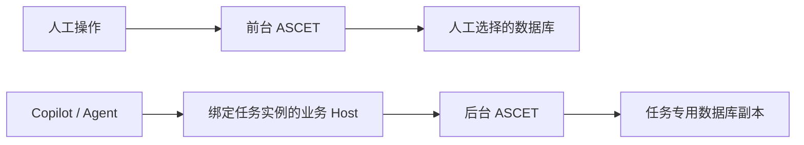

# ASCET 前台人工操作与后台 Agent 工作指南

日期：2026-10-02。适用：ASCET 6.4、现有 Copilot 默认连接方式、私有多实例原型及 C#/.NET 连接器。

## 1. 推荐方案

当前只有一个 Copilot/Agent 需要 Tool API 时，先采用方案 A：**普通 ASCET 专门给 Agent，人工另开原生多实例窗口**。这样可以先保留 Copilot 的默认连接方式，同时把人工切换数据库的操作移到另一进程。

| 方案 | Agent 使用哪个实例 | 人工使用哪个实例 | 适用情况 |
| --- | --- | --- | --- |
| A：先用于当前工作流程 | 普通 ASCET，保持任务数据库，先最小化 | `-multiinstance:manual`，在这里切换其他数据库 | 一个 Agent 需要 API；暂不改 Copilot 连接代码 |
| B：独立端口后台实例 | 私有 `agent-a` / `agent-b`，指定端口，可隐藏 | 独立人工实例 | 多个 Agent/API 实例；还需要接入 Copilot 业务 |

### 1.1 方案 A：当前优先尝试的操作

1. 正常启动普通 ASCET，打开 Agent 要操作的数据库，再连接 Copilot。任务运行期间保留该数据库。
2. 将这个窗口最小化，让 Agent 继续使用它。最小化是后台运行，不是完全隐藏 GUI。
3. 在 PowerShell 中另开人工窗口：

```powershell
& 'E:\ETAS\ASCET6.4\ASCET.exe' -multiinstance:manual
```

也可以使用已提供的人工启动入口：

```powershell
& 'E:\Repo\ASCET\tools\multi-instance\launch-manual.ps1'
```

该脚本只启动原生多实例 GUI，不启动连接器或 API Host。`-Database` 可指定要打开的独立数据库目录，`-InstanceName manual-2` 可另开不同实例。`-WhatIf` 仅显示启动命令，不启动进程。

指定数据库时使用以下形式，并将路径替换为人工要操作的实际数据库目录：

```powershell
& 'E:\Repo\ASCET\tools\multi-instance\launch-manual.ps1' -Database 'D:\YourProject\Database\ManualProject'
```

不要指定 Agent 已经打开的数据库目录。未指定 `-Database` 时由 ASCET 自身决定初始数据库；开始人工操作前确认当前数据库与 Agent 的不同。

4. 在新开的人工窗口中打开、切换其他数据库。通过窗口的实例后缀 `manual` 区分两者。
5. Agent 任务结束后，恢复原普通窗口，检查并保存结果。

建议新建一个名为“ASCET 人工多开”的快捷方式，其目标为：

```text
"E:\ETAS\ASCET6.4\ASCET.exe" -multiinstance:manual
```

后续人工工作从这个快捷方式进入，再在人工窗口内打开数据库。默认快捷方式或双击数据库文件可能复用普通实例，不能用它们切换 Agent 所用实例的数据库。需要第三个人工窗口时，使用不同后缀，例如 `-multiinstance:manual-2`；后缀不能为空。

原生多开窗口的 Tool API 被源码关闭：[`optionToolServer`](E:/Repo/ASCET/unpacked/smalltalk-source/ASDBase.ic/ASDGeneralOptions.st:2436) 在多实例模式直接返回 `false`。人工窗口只需要 GUI 时，这个限制可以接受；普通实例继续提供 Agent 所需的 API。不要把 Agent 改连到这个未经补丁的人工多开窗口。

方案 A 有源码依据，但尚未针对当前使用的 Copilot 发布包做“人工切库时业务继续执行”的端到端测试。首次使用时，应先运行一项短的只读任务，在人工窗口切换数据库，确认 Agent 的目标数据库和任务状态保持不变。

当前隐藏脚本只适用于已准备的私有副本。不能直接用它隐藏原安装的普通 ASCET；方案 A 先使用最小化。

### 1.2 方案 B：后续连接器接入

需要多个 Agent 分别拥有 API，或需要已实现的窗口隐藏功能时，使用独立端口私有实例，并把 Copilot 业务 Host 接到明确指定的实例。

任务开始时固定绑定实例、进程启动时间、API 端口和数据库。切换显示窗口不改变任务目标；让 Agent 操作其他数据库时，为新任务选择另一实例，或等旧任务结束后明确重建会话。



图中是方案 B 的目标业务链路。现有连接器已经实现连接管理，但尚未接入 Copilot 模型业务，不能把图理解为当前已完成的端到端功能。第 4 节给出私有实例和连接器的操作命令，第 7 节说明业务接入需要的改造。

## 2. 当前已经实现到哪里

| 能力 | 当前状态 |
| --- | --- |
| 普通 API 实例与人工原生多开窗口共存 | 源码支持；现有 Copilot 跨人工切库的业务连续性待验 |
| 同时运行多个 ASCET，使用独立 API 端口 | 私有副本原型已验证 |
| 后台隐藏 GUI，保留 UI 消息循环与 API | 已实现；启动期间可能短暂闪现窗口 |
| 显示、再次隐藏后台实例 | 已实现 |
| .NET 8 x64 / .NET Framework 连接后台实例 | 已验证 |
| 校验 PID、启动时间、运行路径及数据库 | 连接器已实现 |
| 同一连接器内并发请求排队、超时、取消、断开 | 已实现；异常回归使用模拟 Host |
| Copilot 模型读取、修改、编译等业务接入后台实例 | 尚未接入、尚未验证 |
| 不同 Agent 进程共享一个后台实例 | 尚未提供共享 Broker |
| Agent 数据库修改自动合并回人工数据库 | 尚未提供 |

本次查看的本地 Copilot 源码中，`AscetSession` 仍通过 `new Ascet()` 建立默认连接，随后读取当前数据库。`AscetLiveContext` 会检查数据库绑定并刷新会话。该源码路径未发现当前连接器或实例 manifest 的接入入口。

这与“切换当前数据库后旧任务无法继续”的现象一致，但未取得故障日志，不能断言每次失败的具体原因或整个 ASCET 进程已经终止。可能变化的是数据库绑定、远程句柄或任务会话。

检查的业务源码未发现“必须只有一个 ASCET 进程”的明确检查。因此，当前重点是保持任务的数据库与连接稳定，不能把现象直接解释为硬性的进程数量限制。

源码定位：

- [AscetSession 默认连接](E:/Rep/AscetAgent/src/ascetcli/src/AscetCopilot/AscetReadDomain.cs:500)
- [数据库绑定检查](E:/Rep/AscetAgent/src/ascetcli/src/AscetCopilot/Core/AscetLiveContext.cs:83)
- [当前调度资源](E:/Rep/AscetAgent/src/services/ascet/runner.ts:985)

检查的是上述本地源码；本次没有确认正在使用的 Copilot 发布包是否来自相同版本。

## 3. 实例分工与数据库规则

方案 A 的分工：

| 用途 | 实例 | 数据库规则 |
| --- | --- | --- |
| Copilot/Agent 当前任务 | 原安装的普通 ASCET | 保留任务数据库；人工不在此窗口切库 |
| 人工日常工作 | 原安装以 `-multiinstance:manual` 另开的 ASCET | 打开其他数据库；不提供 Tool API |

方案 B 在完成 Copilot 业务接入后采用以下分工：

| 用途 | 建议实例 | 使用方式 |
| --- | --- | --- |
| 人工日常工作 | 原安装的 ASCET | 保持前台，可打开其他数据库 |
| 当前 Agent 任务 | `agent-b` | 默认隐藏，固定端口 `127.0.0.1:32612` |
| 另一项独立 Agent 任务 | `agent-a` | 可另行启动，固定端口 `127.0.0.1:32611` |

在本次检查时，原实例 PID 为 `10472`，`agent-b` PID 为 `39168`，其窗口守护程序仍处于 `watching` 状态。PID 是状态快照；重启后以各实例的 `process.json` 为准。

方案 A 不会自动复制数据库。方案 B 的准备工具会复制运行时、配置和数据库；`agent-a`、`agent-b` 都是独立数据库副本，不能把副本名称当作原数据库路径，也不会自动与原数据库同步。

两个进程需要操作同一个项目时，使用独立数据库目录。人工可以查看 Agent 副本的导出结果，或显示 Agent 实例观察进度；不要让两个 ASCET 进程同时对同一个数据库目录执行操作。

首次准备工作区时，从已关闭的数据库或一致的备份复制。`prepare.py` 的前后文件哈希检查不能替代正在使用的数据库的一致性备份。

## 4. 私有后台实例与连接器命令（方案 B）

本节用于操作已经准备的私有副本。它验证后台启动与连接，尚不能让现有 Copilot 自动切换到这些实例执行模型业务。方案 A 的日常操作见第 1.1 节。

以下命令在 PowerShell 7.5+ 中运行。先设置常用路径：

```powershell
$tools = 'E:\Repo\ASCET\tools\multi-instance'
$workspace = 'E:\Repo\ASCET\analysis\multi-instance\2026-10-02\run-01'
$manifest = Join-Path $workspace 'agent-b\instance.json'
```

### 4.1 启动 Agent 后台实例

仅在实例尚未启动时执行：

```powershell
& (Join-Path $tools 'launch.ps1') -Manifest $manifest -Background
```

脚本会输出 PID，并写入 `process.json`。重复启动或端口冲突会报错；它不会自动接管其他进程。当前 `agent-b` 已启动，无需重复执行。

要再启动已准备好的 `agent-a`：

```powershell
& (Join-Path $tools 'launch.ps1') -Manifest (Join-Path $workspace 'agent-a\instance.json') -Background
```

这些命令启动进程并建立窗口守护；是否已经连接到正确数据库，需要通过连接器的身份查询进一步确认。

### 4.2 查看状态

```powershell
& (Join-Path $tools 'windows.ps1') -Manifest $manifest -Action Status
```

`background=true` 表示该进程的窗口守护程序正在运行，不代表模型任务已经开始，也不等同于 API 业务健康检查。

### 4.3 查看 Agent 的 ASCET 窗口

```powershell
& (Join-Path $tools 'windows.ps1') -Manifest $manifest -Action Show
```

显示窗口不会改变 API 端口、数据库或连接，也不会自动暂停 Agent。人工需要修改该实例中的模型时，先通过实际业务系统停止派发并等待在途操作结束；当前连接器没有任务暂停方法。

完成查看后再次隐藏：

```powershell
& (Join-Path $tools 'windows.ps1') -Manifest $manifest -Action Hide
```

如果 API 等待确认框，使用 `Show` 检查窗口。守护程序也会隐藏模态对话框，隐藏窗口不能自动回答需要人工确认的提示。

### 4.4 从 .NET 连接该实例

Agent 项目引用：

`E:\Repo\ASCET\tools\multi-instance\connector\dist\net8.0\Ascet.AgentConnector.dll`

.NET Framework 4.7+ 项目使用 `dist\net47\Ascet.AgentConnector.dll`。

```csharp
using Ascet.AgentConnector;

using var ascet = await AscetConnector.ConnectAsync(new ConnectorOptions {
    ManifestPath = @"E:\Repo\ASCET\analysis\multi-instance\2026-10-02\run-01\agent-b\instance.json",
    AgentId = "task-a"
});

var identity = await ascet.GetIdentityAsync();
int token = await ascet.EchoAsync(123);
```

这段代码验证连接和数据库身份，尚不能启动 Copilot 的模型操作。连接器会启动自己的 x86 `EndpointHost.exe`，必要时打开 manifest 中的私有数据库；它不会启动或隐藏 ASCET 本体。

同一 Agent 进程内共享一个 `ascet` 对象，调用自动串行。另建连接器会收到 `INSTANCE_IN_USE`。释放连接器只断开其 API Host，后台 ASCET 继续运行。

不要同时让这个探针 Host 和另一个 Copilot 业务 Host 各占该实例的一条 Cebra 连接。应由一个持久业务 Host 统一拥有连接；不同 Agent 进程共享时再增加 Broker。

### 4.5 结束工作

1. 等待任务结束，保存并核对结果。
2. 断开 Agent 的连接。
3. 如需退出 ASCET，先 `Show`，使用 ASCET 的正常退出流程。

只有确认是可丢弃的实验副本时，才使用强制清理脚本：

```powershell
& (Join-Path $tools 'stop.ps1') -Manifest $manifest
```

`stop.ps1` 会检查进程身份后强制结束私有 ASCET，不能把它当作保存模型的正常退出方式。

## 5. 什么情况下应该切换

| 情况 | 推荐动作 | 对正在执行的 Agent 任务的要求 |
| --- | --- | --- |
| 人工要处理另一个数据库 | 方案 A：在 `manual` 窗口打开；方案 B：在分配给人工的实例打开 | Agent 保留原实例和原数据库 |
| 人工要查看 Agent 的工作 | 方案 A：恢复最小化窗口；方案 B：执行 `Show`，之后 `Hide` | 不改变连接；人工修改前需停止派发并等待在途操作结束 |
| Agent 要并行处理另一项目 | 给新任务分配另一个实例及 manifest | 原任务继续保留原实例、数据库和会话 |
| 资源不足，需要复用后台实例 | 等旧任务结束，再创建新绑定 | 排空请求、断开连接、清理旧句柄与缓存，核对新数据库后开始新任务 |
| 后台实例被意外切换数据库或退出 | 暂停使用该会话，报告身份变化 | 显式重连并核对任务目标；不自动转到人工实例 |

当前连接器没有 `SwitchDatabase` 方法。项目切换推荐使用另一套重新准备的工作区。`prepare.py --database` 可以指定复制来源，`--output` 和 `--ports` 指定新目录及不同端口；新目录必须位于 `E:\Repo\ASCET\analysis`，且此前不存在。

仅修改 `instance.json` 的数据库、路径或端口，不会重建镜像中固定的配置。不要把编辑 manifest 当作已支持的项目切换操作。

## 6. Agent 结果如何回到人工工作区

方案 A 中，Agent 直接操作普通实例打开的任务数据库。任务结束后在该实例检查、保存即可。

方案 B 中，当前私有后台实例操作的是副本。任务结束后先保存并导出需要的组件或变更记录，核对结果，再通过 ASCET 支持的导入或项目变更流程应用到目标数据库。

人工也改过原项目时，应比较任务开始时的基线、Agent 结果和人工最新结果，处理冲突。不要直接覆盖正在打开的数据库目录。自动合并、变更回收和完整写入验证尚未实现。

## 7. Copilot 要实现该流程，还需要哪些改造

以下改造用于方案 B。方案 A 先保留默认连接入口，通过人工窗口分工避免切换 Agent 的任务数据库。

方案 B 推荐保留现有模型业务服务，在连接入口增加明确的任务目标，优先接通一个后台实例。

1. 每个任务保存 `instance_id`、manifest 路径、端口、PID、启动时间和预期数据库；派发命令时传给对应 Host。
2. C# Host 在首次初始化 Cebra 前注册指定 `ToolEntry`，并隔离 SDK 日志。不能用改写共享注册表的方式切换所有客户端目标。
3. 读取与写入使用同一实例的同一个持久连接。不同实例各有独立 Host；在各自实例内串行执行。
4. 任务执行前后检查数据库及进程身份，重连仍校验原任务目标。目标不可用时明确报错，不回退到默认发现的人工实例。
5. 调度队列、锁、去重键、快照和对象缓存增加实例及进程代次范围。本地 runner 当前仍使用默认调度资源，不能只给界面增加一个端口选项。
6. 已派发任务的目标保持固定；界面选择另一实例只影响明确选择了新目标的新任务。

连接器当前只封装 `identity` 和 `echo`，不能直接替换现有 Copilot 的全部模型接口。业务接入可选择扩展同一个 Host 的业务命令，或把显式端口及身份绑定机制加入现有业务 Host；应避免另建第二条同实例连接。

建议先把指定端口和身份校验接到现有 C# 业务 Host，继续复用现有读取、修改和编译接口。已经验证的注册顺序见 [`EndpointHost.Initialize`](E:/Repo/ASCET/tools/multi-instance/EndpointHost.cs:41)：隔离 Cebra 日志，注册 `ToolEntry("127.0.0.1", port)`，再构造 `Ascet`，最后核对服务端 PID 和数据库。该示例使用当前 ASCET 6.4 SDK 的初始化机制，不能只复制注册端口的一行而省略日志与身份处理。

建议任务界面显示目标实例、数据库和连接状态，并提供显示/隐藏该实例的操作。任务切换、暂停和断开应作用于明确选中的任务，不能由当前前台窗口焦点决定。

## 8. 验收标准与证据

已经记录的验证：

- [独立 API 实例与重启隔离](E:/Repo/ASCET/analysis/multi-instance/2026-10-02/run-01/validation.json)：两个私有实例同时运行，各完成 200 次匹配回显；重启 B 不改变 A 的连接及数据库。
- [后台隐藏与恢复](E:/Repo/ASCET/analysis/multi-instance/2026-10-02/run-01/agent-b/background-validation.json)：隐藏状态完成 200 次 API 回显，显示/隐藏及守护退出通过。
- [.NET 连接器说明](E:/Repo/ASCET/tools/multi-instance/connector/README.md)：两种 .NET 示例真实连接通过；9 项异常回归分别在两种运行时通过，异常场景使用模拟 Host。

方案 A 还需要实际验收：普通实例执行真实 Copilot 业务时，在 `manual` 实例打开、切换和关闭其他数据库，原任务的实例、数据库和业务执行保持不变。

方案 B 接入 Copilot 后还需要实际验收：后台执行真实业务时，在人工实例打开、切换和关闭其他数据库，后台任务的实例及数据库保持不变；第二项任务绑定另一个后台实例；观察窗口不改变绑定；重启或误切后台数据库后旧会话明确失效；可丢弃副本内的小规模写入与读回只影响目标实例。

当前镜像补丁仅支持已校验的 ASCET 6.4 镜像，是私有实验原型。长期运行、模型写入、代码生成和全部工具箱行为尚未验证。
